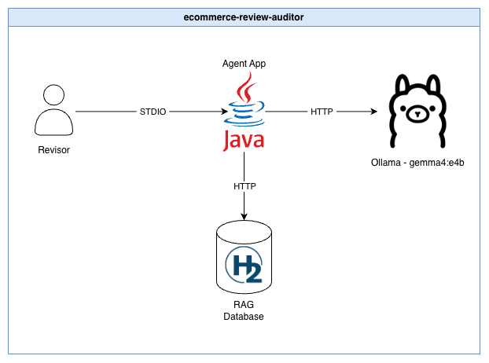
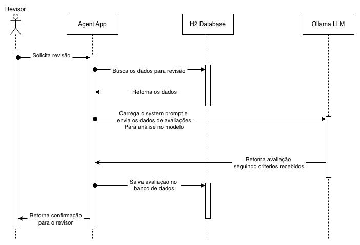
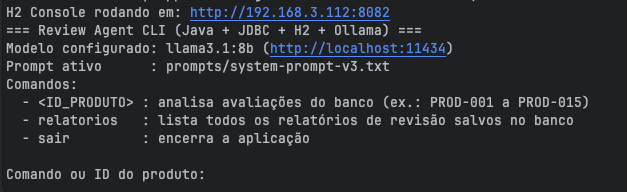
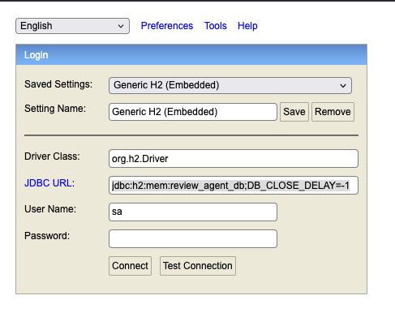
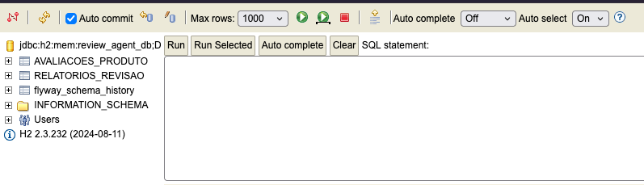

# Revisor de Avaliações de E-commerce (MBA IMPACTA Advanced Generative AI)

Agente de IA desenvolvido para trabalho acadêmico com foco na análise de sessões de comentários e avaliações (1 a 5 estrelas) de produtos em **e-commerce**, identificando divergências entre a nota atribuída e o conteúdo do relato — especialmente quando avaliações negativas refletem fatores externos (logística, atraso, embalagem danificada com produto íntegro ou atendimento do vendedor) e não falhas intrínsecas do produto.

Implementado em **Java puro (sem Spring/frameworks pesados)**, com banco **H2 em memória**, migrações via **Flyway**, acesso a dados via **JDBC**, interface via **terminal (CLI)** e integração com **Ollama local** via `/v1/chat/completions` com `response_format` (`json_schema`).

## Relatório técnico e documentos de apresentação
##### Acesso ao relatório com os processo detalhado, resultado obtidos e informações técnicas: [Relatório técnico](relatorio_tecnico.md)
##### Acesso ao documento de análise técnica: [Análise tecnica](./docs/ecommerce_review_auditor.pdf)
##### Acesso ao documento de apresentação do projeto: [Documento de apresentação do projeto](./docs/Arquiteturas_de_Agentes_de_IA.pptx)

## Pré-requisitos e Como Executar o projeto

### Pré-requisitos
- **JDK 25** (ou compatível com a configuração do projeto) instalado e configurado no `PATH`.
- **Apache Maven** instalado para compilação e execução do projeto.
- **Ollama** instalado e em execução localmente, com o modelo configurado baixado (ex.: `gemma4:e4b`).

### Configuração e Execução
- As configurações de banco H2, Flyway, Ollama e versão do *system prompt* ficam centralizadas em `src/main/resources/application.yaml` (referência a ser atualizada posteriormente conforme o ambiente).
- A execução e os testes do projeto podem ser rodados pela IDE ou via linha de comando conforme documentado no guia de execução do repositório (referência a ser atualizada posteriormente).
- Comandos disponíveis no terminal (CLI):
  - `<ID_PRODUTO>` (ex.: `PROD-001` a `PROD-015`): busca as avaliações no H2 via JDBC, envia ao Ollama (`/v1/chat/completions`), exibe a análise com os IDs e motivos das avaliações divergentes e salva o relatório em `relatorios_revisao` quando houver fator externo real.
  - `relatorios`: lista todos os relatórios de revisão persistidos no banco H2, incluindo IDs das avaliações divergentes, motivos consolidados e detalhes.
  - `sair`: encerra a aplicação.

## Diagramas do Projeto e Visão Geral

### Diagrama de arquitetura de solução


## Diagrama de sequência


## Execução do projeto
### Ambientes Linux:
```bash
./mvnw compile exec:java -Dexec.mainClass=br.com.ecommercereviewauditor.Main
```
### Ambientes Windows:
```powershell
mvnw.exe compile exec:java -Dexec.mainClass=br.com.ecommercereviewauditor.Main
```
### Após a execução dos comando acima o seguinte menu será apresentado:



## Testes automatizados 

### Testes unitários
```bash
./mvnw test
```

### Testes de integração
```bash
./mvnw verify
```

## Acesso ao console do H2 no browser
```browser
URL: http://192.168.3.112:8082
JDBC URL: jdbc:h2:mem:review_agent_db;DB_CLOSE_DELAY=-1
Username: sa
Password: 
```

### H2 database console:


---